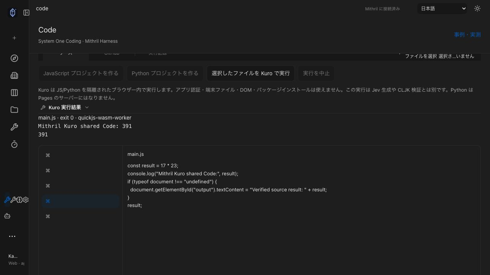
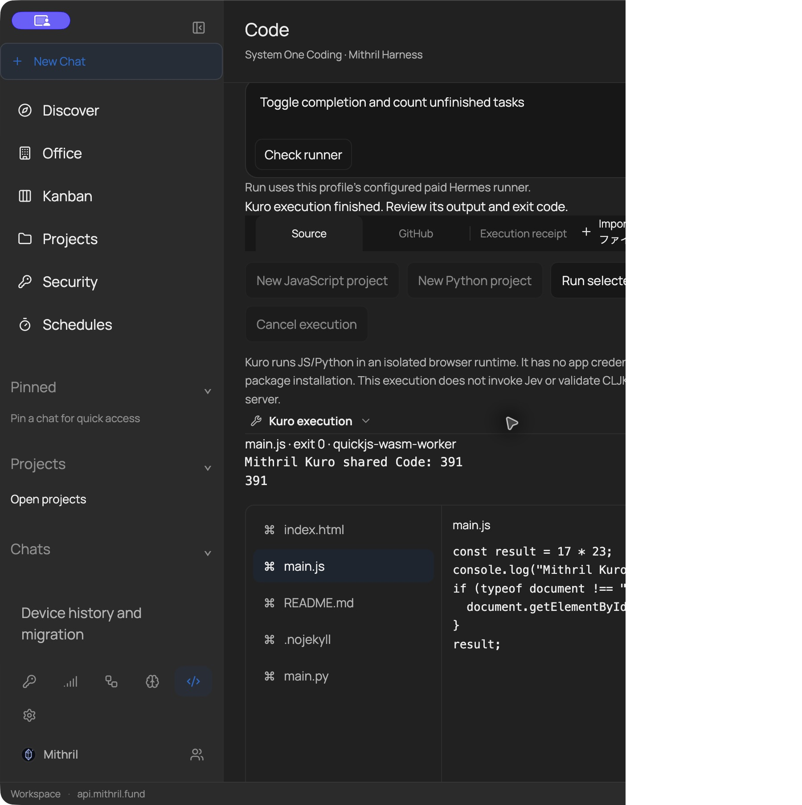
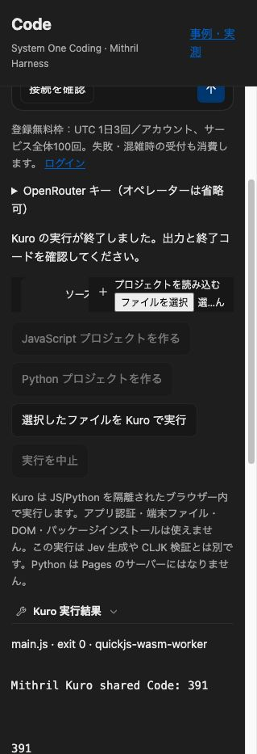
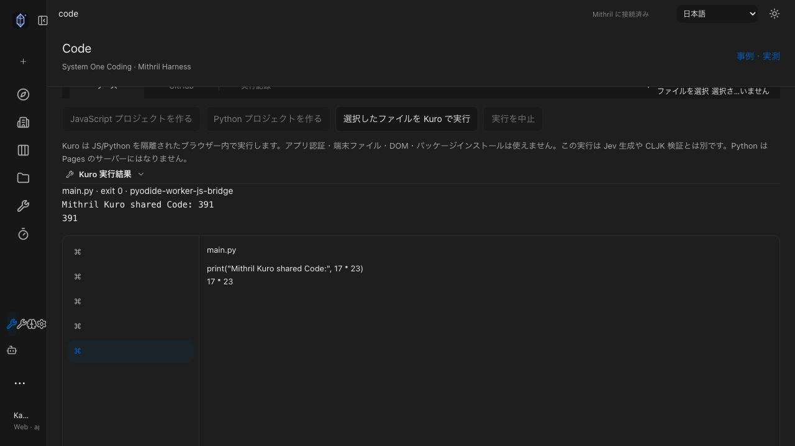
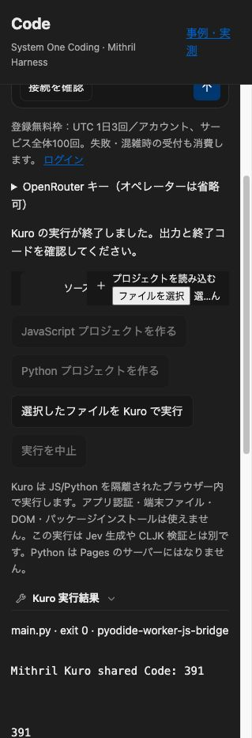
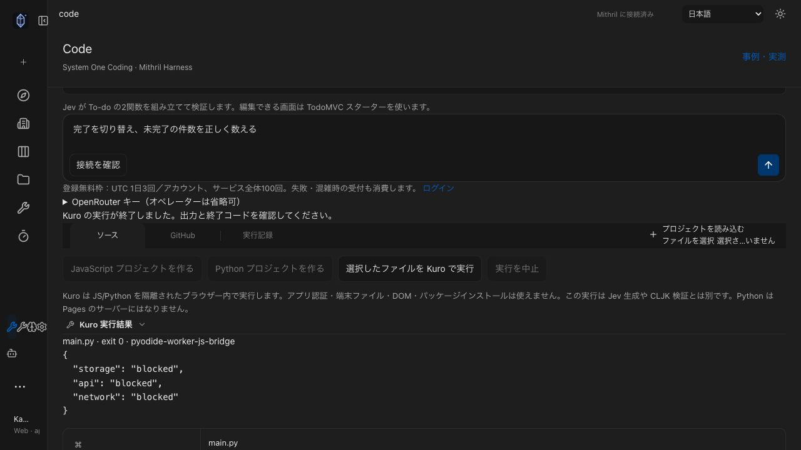

# Shared Code publication through three actual screens

The same editable JS/Python project was created in installed notarized Desktop preview.25, edited in Code Web, then edited in authenticated App `/code`. Every screen saved an actual GitHub commit and explicitly requested Pages publication. At the qualification snapshot, Pages reported d347fce2 built. The evidence branch preserves the main branch and its published source. Only README changed after the initial Desktop source commit. All five final published files matched source bytes and the real public browser displays 391.

## Live Kuro execution

The actual shared screens executed `17 * 23`: JavaScript returned exit 0 and 391 on installed Desktop, authenticated App and Code Web. Python returned exit 0 and 391 on authenticated App and Code Web. Desktop Python loaded all runtime assets but returned deadline exceeded (exit 124); it is not qualified. Code Web Python succeeded after browser operation recovered; Desktop Python again returned exit 124. Extreme local host contention was observed during these checks; causality remains unknown. No sandbox permission or execution deadline was weakened.

Authenticated App also returned exit 0 with API, external network and IndexedDB all blocked. The probe source was restored to the public Python sample without committing it.

The existing real-browser runtime suite independently passed JavaScript/Python, API/network/storage isolation, traversal refusal, output limits, deadlines, cancellation and recovery. These automated results do not replace the live qualification matrix. Editing invalidates execution/saved state; output files are not silently applied.

See [publication.json](publication.json) for exact source/release/commit evidence and limitations. GitHub credentials were transient and disconnected on every screen. This source case does not qualify Jev generation, CLJK compilation, arbitrary repositories, or a Python Pages backend. The separate Jev service later returned `harness_verification_failed`; the earlier run-YsQzP2 remains a distinct, narrowly measured pilot.

